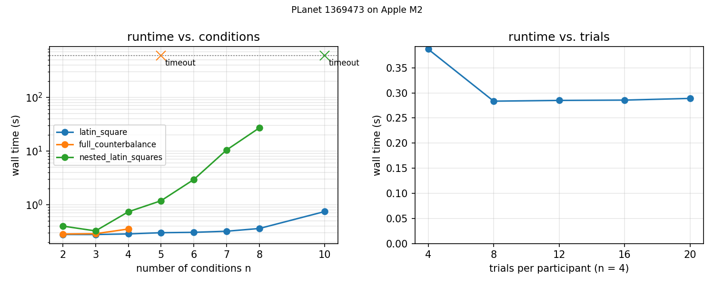

# PLanet performance evaluation

**New version**

- label: `1369473`
- commit: `1369473`
- cpu: `Apple M2`
- memory_gb: `24`
- platform: `macOS-15.8-arm64-arm-64bit`
- python_version: `3.12.0`
- z3_version: `4.13.3`
- python: `/Users/emjun/Git/planet-lang/.venv/bin/python`
- reps: `3`
- timeout: `300.0`
- started: `2026-10-09T22:10:02`
- finished: `2026-10-09T22:12:52`

**Old version**

- label: `1183212`
- commit: `1183212`
- cpu: `Apple M2`
- memory_gb: `24`
- platform: `macOS-15.8-arm64-arm-64bit`
- python_version: `3.12.0`
- z3_version: `4.13.3`
- python: `/Users/emjun/Git/planet-lang/.venv/bin/python`
- reps: `3`
- timeout: `300.0`
- started: `2026-10-09T22:18:07`
- finished: `2026-10-09T22:23:11`

Times in seconds. `wall` is the end-to-end time of one `python program.py` run (the
paper's quantity); `solve` is the z3 part (`Designer.eval`); `assign` includes solving,
random-variable instantiation and participant assignment; `analysis` is `Analysis(...)`
where the program calls it. Medians over completed runs. Note marks rows whose status
changed between versions or whose wall time moved more than 2x.

## Corpus (`src/eval_examples`)

| program | paper name | status | plans x trials | units | wall old | wall new | solve old | solve new | assign new | analysis new | note |
|---|---|---|---|---|---|---|---|---|---|---|---|
| `src/eval_examples/artist.py` | ARTiST (Exp 1) | ok | 4 x 2 | 16 | 0.284 | 0.271 | 0.004 | 0.004 | 0.010 | - |  |
| `src/eval_examples/artist2.py` | ARTiST (Exp 2) | ok | 25 x 5 | 16 | 0.451 | 0.399 | 0.142 | 0.099 | 0.135 | - |  |
| `src/eval_examples/dont_ask_just_tell.py` | Don't Just Tell Me, Ask Me | ok | 204 x 10 | 204 | 0.287 | 0.279 | 0.005 | 0.005 | 0.016 | - |  |
| `src/eval_examples/mousering.py` | MouseRing (Exp 1) | ok | 12 x 600 | 12 | 82.637 | 48.665 | 79.975 | 46.100 | 48.232 | - |  |
| `src/eval_examples/mousering2.py` | MouseRing (Exp 2) | ok | 12 x 200 | 12 | 2.674 | 2.766 | 2.069 | 2.035 | 2.363 | - |  |
| `src/eval_examples/ok_google.py` | OK Google, Let's Learn | ok | 51 x 6 | 51 | 0.295 | 0.300 | 0.008 | 0.010 | 0.020 | - |  |
| `src/eval_examples/perception.py` | Human Augmentation | ok | 506 x 1 | 506 | 0.287 | 0.278 | 0.001 | 0.001 | 0.010 | - |  |
| `src/eval_examples/rambler.py` | Rambler | ok | 2 x 2 | 12 | 0.278 | 0.283 | 0.002 | 0.003 | 0.008 | - |  |
| `src/eval_examples/recommender.py` | When Recommender Systems Snoop | ok | 341 x 1 | 341 | 0.282 | 0.280 | 0.001 | 0.001 | 0.007 | - |  |
| `src/eval_examples/seated_wip.py` | Seated-WIP | ok | 9 x 9 | 18 | 0.803 | 0.722 | 0.504 | 0.425 | 0.451 | - |  |
| `src/eval_examples/shaping_compliance.py` | Shaping Compliance (multifact, nested; Exp ?) | error:ValueError | - | - | - | - | - | - | - | - | ValueError: Sample larger than population or is negative |
| `src/eval_examples/shaping_compliance2.py` | Shaping Compliance (shape; Exp ?) | ok | 12 x 15 | 12 | 0.303 | 0.275 | 0.003 | 0.002 | 0.009 | - |  |
| `src/eval_examples/silver.py` | Silver-Tongued and Sundry | ok | 210 x 10 | 210 | 0.289 | 0.283 | 0.003 | 0.004 | 0.013 | - |  |
| `src/eval_examples/skinergy.py` | Skinergy | ok | 10 x 10 | 10 | 0.285 | 0.271 | 0.003 | 0.003 | 0.009 | - |  |
| `src/eval_examples/sweating_details.py` | Sweating the Details | ok | 12 x 12 | 72 | 0.400 | 0.396 | 0.085 | 0.088 | 0.128 | - |  |

- 14 of 15 programs completed; 12 of them under 1 s; slowest 48.665 s.

## All examples (`src/examples`), regression sweep

| program | status | plans x trials | units | wall old | wall new | solve old | solve new | assign new | analysis new | note |
|---|---|---|---|---|---|---|---|---|---|---|
| `src/examples/analysis/mixed.py` | ok | 3 x 3 | 10 | 0.281 | 0.283 | 0.004 | 0.006 | 0.011 | 0.000 |  |
| `src/examples/analysis/multifact.py` | ok | 8 x 8 | 1 | 0.426 | 0.425 | 0.116 | 0.119 | 0.147 | 0.000 |  |
| `src/examples/analysis/replicate_btw.py` | ok | 48 x 4 | 10 | 0.836 | 2.704 | 0.504 | 2.379 | 2.435 | 0.000 | slower 3.2x |
| `src/examples/balance.py` | ok | 4 x 2 | 4 | 0.294 | 0.287 | 0.006 | 0.009 | 0.016 | 0.000 |  |
| `src/examples/chi2026.py` | ok | 2 x 4 | 12 | 0.287 | 0.288 | 0.005 | 0.015 | 0.021 | - |  |
| `src/examples/cluster.py` | error:ModuleNotFoundError | - | - | - | - | - | - | - | - | ModuleNotFoundError: No module named 'lib' |
| `src/examples/compare.py` | ok | - | - | 0.272 | 0.260 | - | - | - | 0.001 |  |
| `src/examples/compose-btw.py` | ok | 4 x 1 | 48 | 0.282 | 0.270 | 0.002 | 0.002 | 0.007 | 0.000 |  |
| `src/examples/cross.py` | ok | 4 x 2 | 12 | 0.283 | 0.279 | 0.004 | 0.005 | 0.011 | 0.000 |  |
| `src/examples/cross_nest.py` | ok | 6 x 6 | 16 | 0.414 | 0.308 | 0.022 | 0.023 | 0.041 | 0.000 |  |
| `src/examples/cross_test.py` | error:ModuleNotFoundError | - | - | - | - | - | - | - | - | ModuleNotFoundError: No module named 'lib' |
| `src/examples/demo.py` | error:ModuleNotFoundError | - | - | - | - | - | - | - | - | ModuleNotFoundError: No module named 'lib' |
| `src/examples/ffl.py` | ok | 4 x 4 | 16 | 0.303 | 0.298 | 0.008 | 0.009 | 0.020 | 0.000 |  |
| `src/examples/ffl_alt.py` | ok | - | - | 0.275 | 0.292 | - | - | - | 0.000 |  |
| `src/examples/fix-order.py` | ok | 1 x 4 | 16 | 0.280 | 0.270 | 0.001 | 0.001 | 0.006 | 0.000 |  |
| `src/examples/full_counterbalance.py` | ok | 6 x 2 | 48 | 0.284 | 0.283 | 0.005 | 0.006 | 0.013 | 0.000 |  |
| `src/examples/fun.py` | ok | 12 x 2 | 12 | 0.283 | 0.275 | 0.005 | 0.007 | 0.014 | - |  |
| `src/examples/funky_balance.py` | ok | 12 x 2 | 24 | 0.293 | 0.296 | 0.011 | 0.014 | 0.022 | 0.000 |  |
| `src/examples/latin_square.py` | ok | 4 x 2 | 3 | 0.282 | 0.291 | 0.005 | 0.007 | 0.013 | 0.000 |  |
| `src/examples/mixed.py` | ok | 2 x 2 | 1 | 0.287 | 0.284 | 0.002 | 0.003 | 0.008 | 0.000 |  |
| `src/examples/mixed_nest.py` | ok | 4 x 2 | 1 | 0.284 | 0.282 | 0.003 | 0.004 | 0.011 | 0.000 |  |
| `src/examples/multi_but_not_all.py` | ok | 24 x 4 | 1 | 0.400 | 0.392 | 0.098 | 0.091 | 0.121 | - |  |
| `src/examples/multifact.py` | ok | 9 x 9 | 1 | 0.806 | 0.738 | 0.506 | 0.435 | 0.462 | 0.000 |  |
| `src/examples/nest.py` | ok | 8 x 4 | 48 | 0.308 | 0.312 | 0.020 | 0.021 | 0.037 | 0.000 |  |
| `src/examples/nest_random.py` | ok | 4 x 4 | 4 | 0.285 | 0.270 | 0.001 | 0.002 | 0.007 | - |  |
| `src/examples/order_analysis.py` | ok | 4 x 4 | 16 | 0.291 | 0.294 | 0.007 | 0.008 | 0.024 | 0.000 |  |
| `src/examples/random_order.py` | ok | 8 x 2 | 8 | 0.280 | 0.274 | 0.002 | 0.003 | 0.009 | 0.000 |  |
| `src/examples/rank_twice.py` | ok | 1 x 2 | 8 | 0.278 | 0.278 | 0.003 | 0.003 | 0.008 | 0.000 |  |
| `src/examples/ranking.py` | ok | 2 x 2 | 16 | 0.282 | 0.280 | 0.004 | 0.004 | 0.012 | 0.000 |  |
| `src/examples/replicate_btw.py` | ok | 10 x 2 | 10 | 0.281 | 0.295 | 0.002 | 0.003 | 0.008 | 0.000 |  |
| `src/examples/replication/repeat.py` | ok | 6 x 6 | 24 | 0.291 | 0.293 | 0.010 | 0.011 | 0.020 | - |  |
| `src/examples/scaling.py` | timeout | - | - | - | - | - | - | - | - | exceeded 300.0s |
| `src/examples/snapshot.py` | ok | 6 x 2 | 12 | 0.428 | 0.392 | 0.012 | 0.014 | 0.024 | - |  |
| `src/examples/test.py` | ok | 2 x 4 | 10 | 0.294 | 0.269 | 0.005 | 0.005 | 0.011 | - |  |
| `src/examples/tutorial.py` | ok | 6 x 2 | 12 | 0.298 | 0.271 | 0.005 | 0.006 | 0.011 | - |  |
| `src/examples/vis_example.py` | ok | 18 x 9 | - | - | 0.424 | - | 0.128 | - | 0.001 |  |
| `src/examples/weird_counterbalance.py` | ok | 24 x 3 | 4 | 0.539 | 0.322 | 0.242 | 0.050 | 0.064 | - |  |
| `src/examples/weird_rank.py` | ok | 3 x 4 | 16 | 0.300 | 0.267 | 0.004 | 0.005 | 0.011 | - |  |
| `src/examples/whoa.py` | ok | 16 x 4 | 16 | 0.295 | 0.273 | 0.005 | 0.006 | 0.014 | - |  |
| `src/examples/yuwei.py` | ok | 12 x 9 | 12 | 0.290 | 0.267 | 0.002 | 0.002 | 0.009 | - |  |

- status changed: none
- not completing on the new version: `src/examples/cluster.py`, `src/examples/cross_test.py`, `src/examples/demo.py`, `src/examples/scaling.py`

## Scaling

**Scaling run**

- label: `1369473`
- commit: `1369473`
- cpu: `Apple M2`
- memory_gb: `24`
- platform: `macOS-15.8-arm64-arm-64bit`
- python: `/Users/emjun/Git/planet-lang/.venv/bin/python`
- reps: `1`
- timeout: `600.0`
- started: `2026-10-09T22:28:24`
- finished: `2026-10-09T22:49:12`

| family | n | k | trials | status | plans | wall | solve | assign | error |
|---|---|---|---|---|---|---|---|---|---|
| latin_square | 2 | 1 | 2 | ok | 2 | 0.277 | 0.002 | 0.007 |  |
| latin_square | 3 | 1 | 3 | ok | 3 | 0.276 | 0.006 | 0.011 |  |
| latin_square | 4 | 1 | 4 | ok | 4 | 0.283 | 0.012 | 0.019 |  |
| latin_square | 5 | 1 | 5 | ok | 5 | 0.298 | 0.022 | 0.030 |  |
| latin_square | 6 | 1 | 6 | ok | 6 | 0.303 | 0.034 | 0.043 |  |
| latin_square | 7 | 1 | 7 | ok | 7 | 0.318 | 0.048 | 0.058 |  |
| latin_square | 8 | 1 | 8 | ok | 8 | 0.357 | 0.081 | 0.094 |  |
| latin_square | 10 | 1 | 10 | ok | 10 | 0.741 | 0.462 | 0.482 |  |
| full_counterbalance | 2 | 1 | 2 | ok | 2 | 0.282 | 0.002 | 0.007 |  |
| full_counterbalance | 3 | 1 | 3 | ok | 6 | 0.286 | 0.009 | 0.015 |  |
| full_counterbalance | 4 | 1 | 4 | ok | 24 | 0.350 | 0.068 | 0.086 |  |
| full_counterbalance | 5 | 1 | 5 | timeout | - | > 600 | - | - |  |
| nested_latin_squares | 2 | 1 | 2 | ok | 4 | 0.397 | 0.006 | 0.014 |  |
| nested_latin_squares | 3 | 1 | 3 | ok | 9 | 0.322 | 0.040 | 0.065 |  |
| nested_latin_squares | 4 | 1 | 4 | ok | 16 | 0.732 | 0.403 | 0.476 |  |
| nested_latin_squares | 5 | 1 | 5 | ok | 25 | 1.177 | 0.743 | 0.912 |  |
| nested_latin_squares | 6 | 1 | 6 | ok | 36 | 2.925 | 2.299 | 2.656 |  |
| nested_latin_squares | 7 | 1 | 7 | ok | 49 | 10.391 | 9.363 | 10.101 |  |
| nested_latin_squares | 8 | 1 | 8 | ok | 64 | 26.814 | 24.998 | 26.423 |  |
| nested_latin_squares | 10 | 1 | 10 | timeout | - | > 600 | - | - |  |
| trials | 4 | 1 | 4 | ok | 4 | 0.387 | 0.013 | 0.019 |  |
| trials | 4 | 2 | 8 | ok | 4 | 0.284 | 0.014 | 0.022 |  |
| trials | 4 | 3 | 12 | ok | 4 | 0.285 | 0.015 | 0.025 |  |
| trials | 4 | 4 | 16 | ok | 4 | 0.286 | 0.017 | 0.030 |  |
| trials | 4 | 5 | 20 | ok | 4 | 0.289 | 0.020 | 0.035 |  |

- `full_counterbalance` first times out at n = 5 (600 s limit)
- `nested_latin_squares` first times out at n = 10 (600 s limit)

