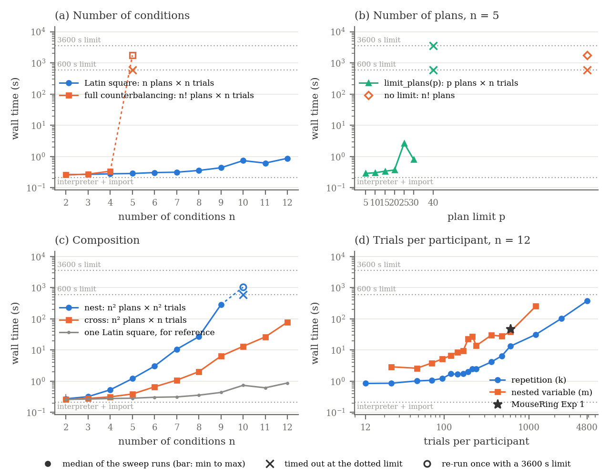

# PLanet performance evaluation

**Version measured**

- label: `b33ade0`
- commit: `b33ade0`
- cpu: `Apple M2`
- memory_gb: `24`
- platform: `macOS-15.8-arm64-arm-64bit`
- python_version: `3.12.0`
- z3_version: `4.13.3`
- python: `/Users/emjun/Git/planet-lang/.venv/bin/python`
- reps: `3`
- timeout: `300.0`
- started: `2026-10-10T20:08:35`
- finished: `2026-10-10T20:11:25`

Times in seconds. `wall` is the end-to-end time of one `python program.py` run (the
paper's quantity); `solve` is the z3 part (`Designer.eval`); `assign` includes solving,
random-variable instantiation and participant assignment; `analysis` is `Analysis(...)`
where the program calls it. Medians over the completed runs (3 per program,
300 s limit each), with the min and max of `wall` alongside.
Note marks rows whose status changed between versions or whose wall time moved more than 2x.

## Corpus (`src/eval_examples`)

| program | paper name | status | plans x trials | units | runs | wall new | wall min..max | solve new | assign new | analysis new | note |
|---|---|---|---|---|---|---|---|---|---|---|---|
| `src/eval_examples/artist.py` | ARTiST (Exp 1) | ok | 4 x 2 | 16 | 3/3 | 0.271 | 0.271..0.344 | 0.005 | 0.011 | - |  |
| `src/eval_examples/artist2.py` | ARTiST (Exp 2) | ok | 25 x 15 | 16 | 3/3 | 1.085 | 1.081..1.096 | 0.707 | 0.817 | - |  |
| `src/eval_examples/dont_ask_just_tell.py` | Don't Just Tell Me, Ask Me | ok | 204 x 10 | 204 | 3/3 | 0.279 | 0.278..0.284 | 0.005 | 0.016 | - |  |
| `src/eval_examples/mousering.py` | MouseRing (Exp 1) | ok | 12 x 600 | 12 | 3/3 | 48.122 | 47.665..48.304 | 45.464 | 47.702 | - |  |
| `src/eval_examples/mousering2.py` | MouseRing (Exp 2) | ok | 12 x 200 | 12 | 3/3 | 2.636 | 2.627..2.711 | 2.035 | 2.363 | - |  |
| `src/eval_examples/ok_google.py` | OK Google, Let's Learn | ok | 51 x 6 | 51 | 3/3 | 0.278 | 0.276..0.283 | 0.010 | 0.019 | - |  |
| `src/eval_examples/perception.py` | Human Augmentation | ok | 506 x 1 | 506 | 3/3 | 0.266 | 0.265..0.267 | 0.001 | 0.009 | - |  |
| `src/eval_examples/rambler.py` | Rambler | ok | 2 x 2 | 12 | 3/3 | 0.265 | 0.263..0.271 | 0.002 | 0.007 | - |  |
| `src/eval_examples/recommender.py` | When Recommender Systems Snoop | ok | 341 x 1 | 341 | 3/3 | 0.264 | 0.264..0.266 | 0.001 | 0.006 | - |  |
| `src/eval_examples/seated_wip.py` | Seated-WIP | ok | 9 x 9 | 18 | 3/3 | 0.715 | 0.713..0.719 | 0.429 | 0.456 | - |  |
| `src/eval_examples/shaping_compliance.py` | Shaping Compliance (Exp 1) | ok | 12 x 36 | 12 | 3/3 | 1.248 | 1.246..1.261 | 0.866 | 0.987 | - |  |
| `src/eval_examples/shaping_compliance2.py` | Shaping Compliance (Exp 2) | ok | 12 x 15 | 12 | 3/3 | 0.268 | 0.267..0.271 | 0.002 | 0.009 | - |  |
| `src/eval_examples/silver.py` | Silver-Tongued and Sundry | ok | 210 x 10 | 210 | 3/3 | 0.271 | 0.271..0.277 | 0.003 | 0.012 | - |  |
| `src/eval_examples/skinergy.py` | Skinergy | ok | 10 x 110 | 10 | 3/3 | 0.306 | 0.304..0.311 | 0.024 | 0.044 | - |  |
| `src/eval_examples/sweating_details.py` | Sweating the Details | ok | 12 x 12 | 72 | 3/3 | 0.393 | 0.390..0.393 | 0.091 | 0.132 | - |  |

- 15 of 15 programs completed; 11 of them under 1 s; slowest 48.122 s.

### Cost drivers

Programs ordered by solver time. `cells` is plans x trials per participant, the size of
the plan matrix the solver fills; it is an upper bound on the work, not a predictor on
its own, since between-subjects programs have large matrices and no ordering
constraints.

| program | paper name | plans | trials/participant | cells | solve | wall |
|---|---|---|---|---|---|---|
| `mousering.py` | MouseRing (Exp 1) | 12 | 600 | 7200 | 45.464 | 48.122 |
| `mousering2.py` | MouseRing (Exp 2) | 12 | 200 | 2400 | 2.035 | 2.636 |
| `shaping_compliance.py` | Shaping Compliance (Exp 1) | 12 | 36 | 432 | 0.866 | 1.248 |
| `artist2.py` | ARTiST (Exp 2) | 25 | 15 | 375 | 0.707 | 1.085 |
| `seated_wip.py` | Seated-WIP | 9 | 9 | 81 | 0.429 | 0.715 |
| `sweating_details.py` | Sweating the Details | 12 | 12 | 144 | 0.091 | 0.393 |
| `skinergy.py` | Skinergy | 10 | 110 | 1100 | 0.024 | 0.306 |
| `ok_google.py` | OK Google, Let's Learn | 51 | 6 | 306 | 0.010 | 0.278 |
| `dont_ask_just_tell.py` | Don't Just Tell Me, Ask Me | 204 | 10 | 2040 | 0.005 | 0.279 |
| `artist.py` | ARTiST (Exp 1) | 4 | 2 | 8 | 0.005 | 0.271 |
| `silver.py` | Silver-Tongued and Sundry | 210 | 10 | 2100 | 0.003 | 0.271 |
| `shaping_compliance2.py` | Shaping Compliance (Exp 2) | 12 | 15 | 180 | 0.002 | 0.268 |
| `rambler.py` | Rambler | 2 | 2 | 4 | 0.002 | 0.265 |
| `perception.py` | Human Augmentation | 506 | 1 | 506 | 0.001 | 0.266 |
| `recommender.py` | When Recommender Systems Snoop | 341 | 1 | 341 | 0.001 | 0.264 |

## All examples (`src/examples`), regression sweep

| program | status | plans x trials | units | runs | wall new | wall min..max | solve new | assign new | analysis new | note |
|---|---|---|---|---|---|---|---|---|---|---|
| `src/examples/analysis/mixed.py` | ok | 3 x 3 | 10 | 1/1 | 0.267 | 0.267..0.267 | 0.006 | 0.011 | 0.000 |  |
| `src/examples/analysis/multifact.py` | ok | 8 x 8 | 1 | 1/1 | 0.403 | 0.403..0.403 | 0.118 | 0.146 | 0.000 |  |
| `src/examples/analysis/replicate_btw.py` | ok | 48 x 4 | 10 | 1/1 | 2.710 | 2.710..2.710 | 2.388 | 2.446 | 0.000 |  |
| `src/examples/balance.py` | ok | 4 x 2 | 4 | 1/1 | 0.280 | 0.280..0.280 | 0.009 | 0.016 | 0.000 |  |
| `src/examples/chi2026.py` | ok | 2 x 4 | 12 | 1/1 | 0.280 | 0.280..0.280 | 0.014 | 0.020 | - |  |
| `src/examples/cluster.py` | error:ModuleNotFoundError | - | - | 0/1 | - | - | - | - | - | ModuleNotFoundError: No module named 'lib' |
| `src/examples/compare.py` | ok | - | - | 1/1 | 0.256 | 0.256..0.256 | - | - | 0.000 |  |
| `src/examples/compose-btw.py` | ok | 4 x 1 | 48 | 1/1 | 0.267 | 0.267..0.267 | 0.002 | 0.007 | 0.000 |  |
| `src/examples/cross.py` | ok | 4 x 2 | 12 | 1/1 | 0.270 | 0.270..0.270 | 0.004 | 0.011 | 0.000 |  |
| `src/examples/cross_nest.py` | ok | 6 x 6 | 16 | 1/1 | 0.300 | 0.300..0.300 | 0.024 | 0.042 | 0.000 |  |
| `src/examples/cross_test.py` | error:ModuleNotFoundError | - | - | 0/1 | - | - | - | - | - | ModuleNotFoundError: No module named 'lib' |
| `src/examples/demo.py` | error:ModuleNotFoundError | - | - | 0/1 | - | - | - | - | - | ModuleNotFoundError: No module named 'lib' |
| `src/examples/ffl.py` | ok | 4 x 4 | 16 | 1/1 | 0.279 | 0.279..0.279 | 0.009 | 0.019 | 0.000 |  |
| `src/examples/ffl_alt.py` | ok | - | - | 1/1 | 0.256 | 0.256..0.256 | - | - | 0.000 |  |
| `src/examples/fix-order.py` | ok | 1 x 4 | 16 | 1/1 | 0.265 | 0.265..0.265 | 0.001 | 0.006 | 0.000 |  |
| `src/examples/full_counterbalance.py` | ok | 6 x 2 | 48 | 1/1 | 0.276 | 0.276..0.276 | 0.006 | 0.012 | 0.000 |  |
| `src/examples/fun.py` | ok | 4 x 2 | 12 | 1/1 | 0.272 | 0.272..0.272 | 0.007 | 0.014 | - |  |
| `src/examples/funky_balance.py` | ok | 12 x 2 | 24 | 1/1 | 0.284 | 0.284..0.284 | 0.014 | 0.022 | 0.000 |  |
| `src/examples/latin_square.py` | ok | 4 x 2 | 3 | 1/1 | 0.272 | 0.272..0.272 | 0.006 | 0.012 | 0.000 |  |
| `src/examples/mixed.py` | ok | 2 x 2 | 1 | 1/1 | 0.268 | 0.268..0.268 | 0.002 | 0.008 | 0.000 |  |
| `src/examples/mixed_nest.py` | ok | 4 x 2 | 1 | 1/1 | 0.269 | 0.269..0.269 | 0.004 | 0.010 | 0.000 |  |
| `src/examples/multi_but_not_all.py` | ok | 24 x 4 | 1 | 1/1 | 0.383 | 0.383..0.383 | 0.094 | 0.123 | - |  |
| `src/examples/multifact.py` | ok | 9 x 9 | 1 | 1/1 | 0.713 | 0.713..0.713 | 0.426 | 0.452 | 0.000 |  |
| `src/examples/nest.py` | ok | 8 x 4 | 48 | 1/1 | 0.300 | 0.300..0.300 | 0.021 | 0.036 | 0.000 |  |
| `src/examples/nest_random.py` | ok | 4 x 4 | 4 | 1/1 | 0.262 | 0.262..0.262 | 0.001 | 0.006 | - |  |
| `src/examples/order_analysis.py` | ok | 4 x 4 | 16 | 1/1 | 0.276 | 0.276..0.276 | 0.008 | 0.018 | 0.000 |  |
| `src/examples/random_order.py` | ok | 8 x 2 | 8 | 1/1 | 0.266 | 0.266..0.266 | 0.003 | 0.008 | 0.000 |  |
| `src/examples/rank_twice.py` | ok | 1 x 2 | 8 | 1/1 | 0.265 | 0.265..0.265 | 0.003 | 0.007 | 0.000 |  |
| `src/examples/ranking.py` | ok | 2 x 2 | 16 | 1/1 | 0.267 | 0.267..0.267 | 0.004 | 0.009 | 0.000 |  |
| `src/examples/replicate_btw.py` | ok | 10 x 2 | 10 | 1/1 | 0.267 | 0.267..0.267 | 0.003 | 0.008 | 0.000 |  |
| `src/examples/replication/repeat.py` | ok | 6 x 6 | 24 | 1/1 | 0.285 | 0.285..0.285 | 0.011 | 0.020 | - |  |
| `src/examples/scaling.py` | timeout | - | - | 0/1 | - | - | - | - | - | exceeded 300.0s |
| `src/examples/snapshot.py` | ok | 6 x 2 | 12 | 1/1 | 0.401 | 0.401..0.401 | 0.014 | 0.025 | - |  |
| `src/examples/test.py` | ok | 2 x 4 | 10 | 1/1 | 0.270 | 0.270..0.270 | 0.005 | 0.011 | - |  |
| `src/examples/tutorial.py` | ok | 6 x 2 | 12 | 1/1 | 0.269 | 0.269..0.269 | 0.006 | 0.012 | - |  |
| `src/examples/weird_counterbalance.py` | ok | 24 x 3 | 4 | 1/1 | 0.325 | 0.325..0.325 | 0.051 | 0.065 | - |  |
| `src/examples/weird_rank.py` | ok | 3 x 4 | 16 | 1/1 | 0.269 | 0.269..0.269 | 0.005 | 0.011 | - |  |
| `src/examples/whoa.py` | ok | 16 x 4 | 16 | 1/1 | 0.282 | 0.282..0.282 | 0.006 | 0.015 | - |  |
| `src/examples/yuwei.py` | ok | 12 x 9 | 12 | 1/1 | 0.273 | 0.273..0.273 | 0.002 | 0.009 | - |  |

- status changed: none
- not completing on the new version: `src/examples/cluster.py`, `src/examples/cross_test.py`, `src/examples/demo.py`, `src/examples/scaling.py`

## Scaling

**Scaling sweep**

- label: `b33ade0`
- commit: `b33ade0`
- cpu: `Apple M2`
- memory_gb: `24`
- platform: `macOS-15.8-arm64-arm-64bit`
- python: `/Users/emjun/Git/planet-lang/.venv/bin/python`
- reps: `3`
- timeout: `600.0`
- families: `['latin_square', 'full_counterbalance', 'plans', 'nested_latin_squares', 'crossed_latin_squares', 'trials', 'nested_variable']`
- bases: `{'plans': {'n': 5}, 'trials': {'n': 12}, 'nested_variable': {'n': 12}}`
- started: `2026-10-10T20:16:39`
- finished: `2026-10-10T22:00:05`

**Re-run of the timed-out points**

- label: `b33ade0`
- commit: `b33ade0`
- cpu: `Apple M2`
- memory_gb: `24`
- platform: `macOS-15.8-arm64-arm-64bit`
- python: `/Users/emjun/Git/planet-lang/.venv/bin/python`
- reps: `1`
- timeout: `3600.0`
- rerun_of: `scaling_b33ade0.json`
- started: `2026-10-10T22:00:05`
- finished: `2026-10-10T23:46:32`

Each row is one generated program (in `scaling_b33ade0_programs/`), run 3 time(s) with a limit of 600 s per run. `wall` and `solve` are medians over the completed runs, with the min and max of `wall` alongside. Every family sweeps one parameter, its axis, of a design built on a Latin square and keeps the rest fixed (`base n`). `expected` is the plan count and width (trials per participant) the semantics predicts for the design; `measured` is the shape of the plan matrix the solver produced.

| family | axis | x | base n | expected plans x width | measured plans x trials | status | ok/runs | wall | wall min..max | solve | assign | error |
|---|---|---|---|---|---|---|---|---|---|---|---|---|
| latin_square | n | 2 | 2 | 2 x 2 | 2 x 2 | ok | 3/3 | 0.263 | 0.262..0.264 | 0.002 | 0.007 |  |
| latin_square | n | 3 | 3 | 3 x 3 | 3 x 3 | ok | 3/3 | 0.268 | 0.267..0.272 | 0.006 | 0.011 |  |
| latin_square | n | 4 | 4 | 4 x 4 | 4 x 4 | ok | 3/3 | 0.280 | 0.275..0.284 | 0.012 | 0.019 |  |
| latin_square | n | 5 | 5 | 5 x 5 | 5 x 5 | ok | 3/3 | 0.286 | 0.285..0.287 | 0.022 | 0.030 |  |
| latin_square | n | 6 | 6 | 6 x 6 | 6 x 6 | ok | 3/3 | 0.307 | 0.305..0.308 | 0.035 | 0.044 |  |
| latin_square | n | 7 | 7 | 7 x 7 | 7 x 7 | ok | 3/3 | 0.315 | 0.315..0.315 | 0.048 | 0.058 |  |
| latin_square | n | 8 | 8 | 8 x 8 | 8 x 8 | ok | 3/3 | 0.358 | 0.356..0.359 | 0.083 | 0.096 |  |
| latin_square | n | 9 | 9 | 9 x 9 | 9 x 9 | ok | 3/3 | 0.438 | 0.437..0.438 | 0.164 | 0.180 |  |
| latin_square | n | 10 | 10 | 10 x 10 | 10 x 10 | ok | 3/3 | 0.741 | 0.737..0.752 | 0.464 | 0.483 |  |
| latin_square | n | 11 | 11 | 11 x 11 | 11 x 11 | ok | 3/3 | 0.617 | 0.614..0.622 | 0.335 | 0.356 |  |
| latin_square | n | 12 | 12 | 12 x 12 | 12 x 12 | ok | 3/3 | 0.878 | 0.846..0.911 | 0.575 | 0.603 |  |
| full_counterbalance | n | 2 | 2 | 2 x 2 | 2 x 2 | ok | 3/3 | 0.258 | 0.257..0.260 | 0.002 | 0.007 |  |
| full_counterbalance | n | 3 | 3 | 6 x 3 | 6 x 3 | ok | 3/3 | 0.273 | 0.269..0.274 | 0.009 | 0.015 |  |
| full_counterbalance | n | 4 | 4 | 24 x 4 | 24 x 4 | ok | 3/3 | 0.339 | 0.338..0.346 | 0.068 | 0.087 |  |
| full_counterbalance | n | 5 | 5 | 120 x 5 | - | timeout | 0/1 | > 600 | - | - | - |  |
| plans | p | 5 | 5 | 5 x 5 | 5 x 5 | ok | 3/3 | 0.289 | 0.285..0.295 | 0.022 | 0.030 |  |
| plans | p | 10 | 5 | 10 x 5 | 10 x 5 | ok | 3/3 | 0.303 | 0.303..0.310 | 0.039 | 0.050 |  |
| plans | p | 15 | 5 | 15 x 5 | 15 x 5 | ok | 3/3 | 0.340 | 0.334..0.341 | 0.066 | 0.081 |  |
| plans | p | 20 | 5 | 20 x 5 | 20 x 5 | ok | 3/3 | 0.370 | 0.368..0.370 | 0.095 | 0.114 |  |
| plans | p | 25 | 5 | 25 x 5 | 25 x 5 | ok | 3/3 | 2.672 | 2.669..2.676 | 2.392 | 2.417 |  |
| plans | p | 30 | 5 | 30 x 5 | 30 x 5 | ok | 3/3 | 0.799 | 0.799..0.804 | 0.517 | 0.545 |  |
| plans | p | 40 | 5 | 40 x 5 | - | timeout | 0/1 | > 600 | - | - | - |  |
| nested_latin_squares | n | 2 | 2 | 4 x 4 | 4 x 4 | ok | 3/3 | 0.274 | 0.269..0.373 | 0.006 | 0.014 |  |
| nested_latin_squares | n | 3 | 3 | 9 x 9 | 9 x 9 | ok | 3/3 | 0.321 | 0.321..0.324 | 0.043 | 0.069 |  |
| nested_latin_squares | n | 4 | 4 | 16 x 16 | 16 x 16 | ok | 3/3 | 0.532 | 0.514..0.533 | 0.200 | 0.272 |  |
| nested_latin_squares | n | 5 | 5 | 25 x 25 | 25 x 25 | ok | 3/3 | 1.212 | 1.187..1.235 | 0.768 | 0.949 |  |
| nested_latin_squares | n | 6 | 6 | 36 x 36 | 36 x 36 | ok | 3/3 | 3.055 | 3.022..3.064 | 2.392 | 2.773 |  |
| nested_latin_squares | n | 7 | 7 | 49 x 49 | 49 x 49 | ok | 3/3 | 10.586 | 10.558..10.615 | 9.452 | 10.252 |  |
| nested_latin_squares | n | 8 | 8 | 64 x 64 | 64 x 64 | ok | 3/3 | 26.857 | 26.804..26.976 | 25.102 | 26.483 |  |
| nested_latin_squares | n | 9 | 9 | 81 x 81 | 81 x 81 | ok | 3/3 | 284.420 | 282.792..284.649 | 281.063 | 283.968 |  |
| nested_latin_squares | n | 10 | 10 | 100 x 100 | - | timeout | 0/1 | > 600 | - | - | - |  |
| crossed_latin_squares | n | 2 | 2 | 4 x 2 | 4 x 2 | ok | 3/3 | 0.261 | 0.260..0.369 | 0.004 | 0.010 |  |
| crossed_latin_squares | n | 3 | 3 | 9 x 3 | 9 x 3 | ok | 3/3 | 0.282 | 0.278..0.285 | 0.016 | 0.026 |  |
| crossed_latin_squares | n | 4 | 4 | 16 x 4 | 16 x 4 | ok | 3/3 | 0.316 | 0.316..0.323 | 0.043 | 0.063 |  |
| crossed_latin_squares | n | 5 | 5 | 25 x 5 | 25 x 5 | ok | 3/3 | 0.390 | 0.388..0.394 | 0.098 | 0.134 |  |
| crossed_latin_squares | n | 6 | 6 | 36 x 6 | 36 x 6 | ok | 3/3 | 0.661 | 0.660..0.666 | 0.341 | 0.405 |  |
| crossed_latin_squares | n | 7 | 7 | 49 x 7 | 49 x 7 | ok | 3/3 | 1.084 | 1.081..1.108 | 0.717 | 0.829 |  |
| crossed_latin_squares | n | 8 | 8 | 64 x 8 | 64 x 8 | ok | 3/3 | 2.025 | 2.022..2.027 | 1.593 | 1.759 |  |
| crossed_latin_squares | n | 9 | 9 | 81 x 9 | 81 x 9 | ok | 3/3 | 6.403 | 6.298..6.505 | 5.873 | 6.130 |  |
| crossed_latin_squares | n | 10 | 10 | 100 x 10 | 100 x 10 | ok | 3/3 | 13.119 | 13.045..13.174 | 12.456 | 12.834 |  |
| crossed_latin_squares | n | 11 | 11 | 121 x 11 | 121 x 11 | ok | 3/3 | 26.341 | 26.322..26.505 | 25.526 | 26.053 |  |
| crossed_latin_squares | n | 12 | 12 | 144 x 12 | 144 x 12 | ok | 3/3 | 78.176 | 77.817..78.268 | 77.082 | 77.877 |  |
| trials | k | 1 | 12 | 12 x 12 | 12 x 12 | ok | 3/3 | 0.853 | 0.843..0.934 | 0.561 | 0.588 |  |
| trials | k | 2 | 12 | 12 x 24 | 12 x 24 | ok | 3/3 | 0.865 | 0.861..0.893 | 0.557 | 0.603 |  |
| trials | k | 4 | 12 | 12 x 48 | 12 x 48 | ok | 3/3 | 1.023 | 0.997..1.028 | 0.680 | 0.769 |  |
| trials | k | 6 | 12 | 12 x 72 | 12 x 72 | ok | 3/3 | 1.076 | 1.069..1.076 | 0.681 | 0.811 |  |
| trials | k | 8 | 12 | 12 x 96 | 12 x 96 | ok | 3/3 | 1.230 | 1.224..1.249 | 0.795 | 0.975 |  |
| trials | k | 10 | 12 | 12 x 120 | 12 x 120 | ok | 3/3 | 1.724 | 1.710..1.729 | 1.257 | 1.469 |  |
| trials | k | 12 | 12 | 12 x 144 | 12 x 144 | ok | 3/3 | 1.675 | 1.653..1.696 | 1.167 | 1.413 |  |
| trials | k | 14 | 12 | 12 x 168 | 12 x 168 | ok | 3/3 | 1.742 | 1.725..1.743 | 1.188 | 1.485 |  |
| trials | k | 16 | 12 | 12 x 192 | 12 x 192 | ok | 3/3 | 2.020 | 2.014..2.021 | 1.424 | 1.763 |  |
| trials | k | 18 | 12 | 12 x 216 | 12 x 216 | ok | 3/3 | 2.528 | 2.493..2.537 | 1.882 | 2.271 |  |
| trials | k | 20 | 12 | 12 x 240 | 12 x 240 | ok | 3/3 | 2.509 | 2.502..2.516 | 1.818 | 2.249 |  |
| trials | k | 30 | 12 | 12 x 360 | 12 x 360 | ok | 3/3 | 4.154 | 4.057..4.208 | 3.284 | 3.885 |  |
| trials | k | 40 | 12 | 12 x 480 | 12 x 480 | ok | 3/3 | 6.524 | 6.428..6.663 | 5.406 | 6.259 |  |
| trials | k | 50 | 12 | 12 x 600 | 12 x 600 | ok | 3/3 | 13.199 | 13.108..13.217 | 11.871 | 12.923 |  |
| trials | k | 100 | 12 | 12 x 1200 | 12 x 1200 | ok | 3/3 | 31.479 | 31.358..31.656 | 29.048 | 31.188 |  |
| trials | k | 200 | 12 | 12 x 2400 | 12 x 2400 | ok | 3/3 | 102.502 | 102.291..103.945 | 97.765 | 102.071 |  |
| trials | k | 400 | 12 | 12 x 4800 | 12 x 4800 | ok | 3/3 | 373.815 | 365.217..381.237 | 364.918 | 373.273 |  |
| nested_variable | m | 2 | 12 | 12 x 24 | 12 x 24 | ok | 3/3 | 2.902 | 2.890..2.983 | 2.544 | 2.630 |  |
| nested_variable | m | 4 | 12 | 12 x 48 | 12 x 48 | ok | 3/3 | 2.614 | 2.600..2.634 | 2.180 | 2.346 |  |
| nested_variable | m | 6 | 12 | 12 x 72 | 12 x 72 | ok | 3/3 | 3.841 | 3.832..3.861 | 3.322 | 3.575 |  |
| nested_variable | m | 8 | 12 | 12 x 96 | 12 x 96 | ok | 3/3 | 5.190 | 5.164..5.191 | 4.580 | 4.917 |  |
| nested_variable | m | 10 | 12 | 12 x 120 | 12 x 120 | ok | 3/3 | 6.626 | 6.572..6.628 | 5.930 | 6.353 |  |
| nested_variable | m | 12 | 12 | 12 x 144 | 12 x 144 | ok | 3/3 | 8.549 | 8.518..8.571 | 7.758 | 8.279 |  |
| nested_variable | m | 14 | 12 | 12 x 168 | 12 x 168 | ok | 3/3 | 9.379 | 9.253..9.593 | 8.475 | 9.096 |  |
| nested_variable | m | 16 | 12 | 12 x 192 | 12 x 192 | ok | 3/3 | 22.376 | 22.209..22.428 | 21.374 | 22.096 |  |
| nested_variable | m | 18 | 12 | 12 x 216 | 12 x 216 | ok | 3/3 | 27.063 | 26.961..27.548 | 25.995 | 26.775 |  |
| nested_variable | m | 20 | 12 | 12 x 240 | 12 x 240 | ok | 3/3 | 13.860 | 13.832..14.524 | 12.661 | 13.534 |  |
| nested_variable | m | 30 | 12 | 12 x 360 | 12 x 360 | ok | 3/3 | 29.914 | 29.901..30.545 | 28.288 | 29.616 |  |
| nested_variable | m | 40 | 12 | 12 x 480 | 12 x 480 | ok | 3/3 | 27.971 | 27.723..28.060 | 25.903 | 27.660 |  |
| nested_variable | m | 50 | 12 | 12 x 600 | 12 x 600 | ok | 3/3 | 38.100 | 37.822..39.033 | 35.458 | 37.759 |  |
| nested_variable | m | 100 | 12 | 12 x 1200 | 12 x 1200 | ok | 3/3 | 253.951 | 252.655..255.497 | 247.701 | 253.474 |  |

### Timeouts

The sweep limit was 600 s per run. A family stops at its first timed-out point: the remaining runs of that point and all larger values of its axis were not attempted, so a timeout is the last row of its family above.
The timed-out points were then re-run 1 time(s) each with a limit of 3600 s (`scaling_long_b33ade0.json`, started 2026-10-10T22:00:05). Those runs are listed in the last column and drawn with hollow markers in the figure; they are not part of the sweep medians.

| family | last completed point | first timeout in the sweep (600 s) | re-run at 3600 s |
|---|---|---|---|
| latin_square | n = 12: 0.878 s | none | - |
| full_counterbalance | n = 4: 0.339 s | n = 5 (120 plans x 5 trials) | completed: wall 1752.383 s, solve 1751.862 s (1 run(s)) |
| plans | p = 30: 0.799 s | p = 40 (40 plans x 5 trials) | still over 3600 s |
| nested_latin_squares | n = 9: 284.420 s | n = 10 (100 plans x 100 trials) | completed: wall 1034.640 s, solve 1028.382 s (1 run(s)) |
| crossed_latin_squares | n = 12: 78.176 s | none | - |
| trials | k = 400: 373.815 s | none | - |
| nested_variable | m = 100: 253.951 s | none | - |

Figure: wall time against each family's axis, log scale. Filled markers are sweep medians with a thin bar from min to max; a cross at a dotted limit line is a timeout at that limit; a hollow marker is the re-run of a timed-out point at the longer limit, joined to the sweep by a dashed segment; the lowest dotted line is the interpreter start-up and import floor. Also written as `scaling.pdf` for the paper.
