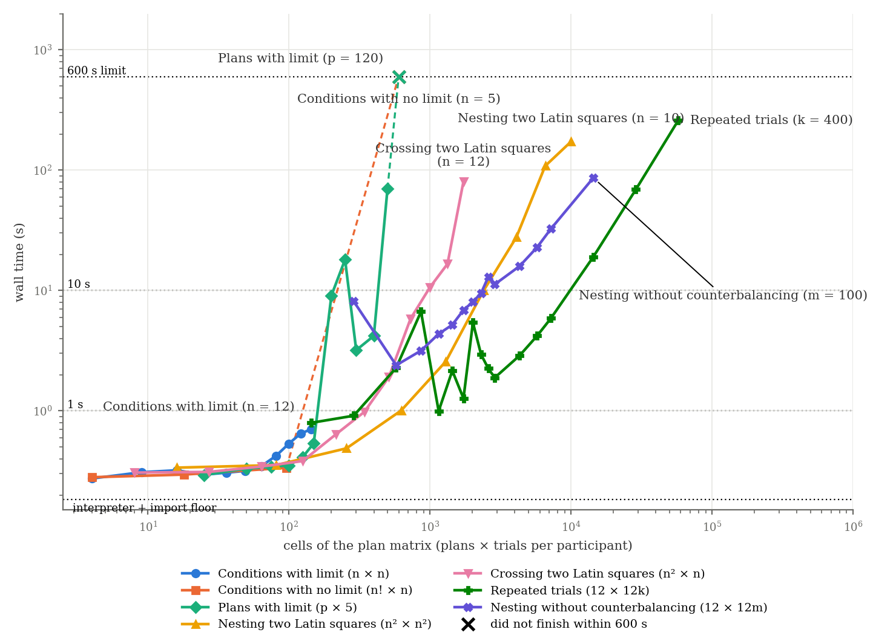
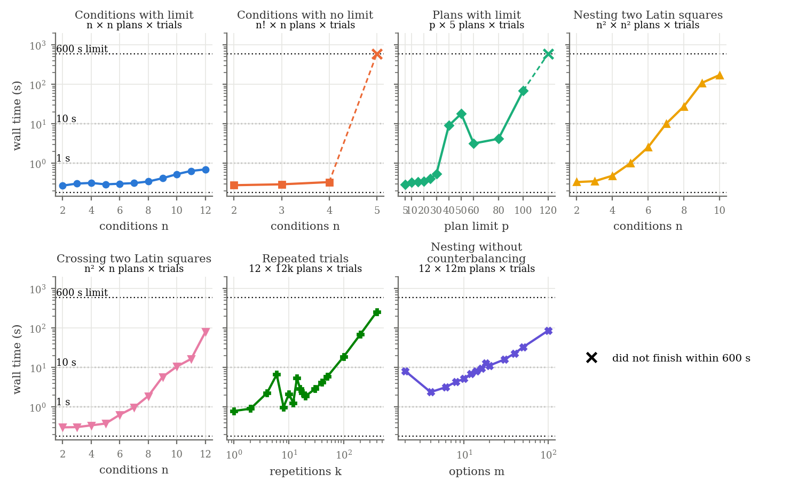

# PLanet performance evaluation

**New version**

- label: `03a6f15`
- commit: `03a6f15`
- cpu: `AMD EPYC 9555 64-Core Processor`
- memory_gb: `1511`
- platform: `Linux-6.8.0-138-generic-x86_64-with-glibc2.39`
- python_version: `3.12.13`
- z3_version: `4.13.3`
- python: `/scratch/xs307/Projects/planet/.amp/venv-bench/bin/python`
- reps: `3`
- timeout: `300.0`
- started: `2026-10-12T04:02:53`
- finished: `2026-10-12T04:05:01`

**Old version**

- label: `810b45c`
- commit: `None`
- cpu: `AMD EPYC 9555 64-Core Processor`
- memory_gb: `1511`
- platform: `Linux-6.8.0-138-generic-x86_64-with-glibc2.39`
- python_version: `3.12.13`
- z3_version: `4.13.3`
- python: `/scratch/xs307/Projects/planet/.amp/venv-bench/bin/python`
- reps: `3`
- timeout: `300.0`
- started: `2026-10-12T04:02:53`
- finished: `2026-10-12T04:05:01`

Times in seconds. `wall` is the end-to-end time of one `python program.py` run (the
paper's quantity); `solve` is the z3 part (`Designer.eval`); `assign` includes solving,
random-variable instantiation and participant assignment; `analysis` is `Analysis(...)`
where the program calls it. Medians over the completed runs (3 per program,
300 s limit each), with the min and max of `wall` alongside.
Note marks rows whose status changed between versions or whose wall time moved more than 2x.

## Corpus (`src/eval_examples`)

| program | paper name | status | plans x trials | units | runs | wall old | wall new | wall min..max | solve old | solve new | assign new | analysis new | note |
|---|---|---|---|---|---|---|---|---|---|---|---|---|---|
| `src/eval_examples/artist.py` | ARTiST (Exp 1) | ok | 4 x 2 | 16 | 3/3 | 0.305 | 0.297 | 0.280..0.332 | 0.004 | 0.004 | 0.019 | - |  |
| `src/eval_examples/artist2.py` | ARTiST (Exp 2) | ok -> error:ValueError | - | - | 0/3 | 0.693 | - | - | 0.327 | - | - | - | status changed |
| `src/eval_examples/dont_ask_just_tell.py` | Don't Just Tell Me, Ask Me | ok | 204 x 10 | 204 | 3/3 | 0.303 | 0.291 | 0.279..0.292 | 0.005 | 0.004 | 0.024 | - |  |
| `src/eval_examples/mousering.py` | MouseRing (Exp 1) | ok | 12 x 600 | 12 | 3/3 | 35.791 | 35.792 | 35.742..35.937 | 33.659 | 33.679 | 35.423 | - |  |
| `src/eval_examples/mousering2.py` | MouseRing (Exp 2) | ok | 12 x 200 | 12 | 3/3 | 1.674 | 1.684 | 1.682..1.697 | 1.174 | 1.195 | 1.429 | - |  |
| `src/eval_examples/ok_google.py` | OK Google, Let's Learn | ok | 51 x 6 | 51 | 3/3 | 0.283 | 0.287 | 0.282..0.289 | 0.008 | 0.008 | 0.022 | - |  |
| `src/eval_examples/perception.py` | Human Augmentation | ok | 506 x 1 | 506 | 3/3 | 0.269 | 0.274 | 0.269..0.283 | 0.001 | 0.001 | 0.016 | - |  |
| `src/eval_examples/rambler.py` | Rambler | ok | 2 x 2 | 12 | 3/3 | 0.286 | 0.272 | 0.270..0.282 | 0.002 | 0.002 | 0.014 | - |  |
| `src/eval_examples/recommender.py` | When Recommender Systems Snoop | ok | 341 x 1 | 341 | 3/3 | 0.268 | 0.277 | 0.275..0.279 | 0.001 | 0.001 | 0.015 | - |  |
| `src/eval_examples/seated_wip.py` | Seated-WIP | ok | 9 x 9 | 18 | 3/3 | 0.429 | 0.437 | 0.434..0.443 | 0.153 | 0.153 | 0.179 | - |  |
| `src/eval_examples/shaping_compliance.py` | Shaping Compliance (Exp 1) | ok | 12 x 36 | 12 | 3/3 | 1.321 | 1.326 | 1.313..1.330 | 0.971 | 0.970 | 1.065 | - |  |
| `src/eval_examples/shaping_compliance2.py` | Shaping Compliance (Exp 2) | ok | 12 x 15 | 12 | 3/3 | 0.275 | 0.268 | 0.268..0.271 | 0.002 | 0.002 | 0.016 | - |  |
| `src/eval_examples/silver.py` | Silver-Tongued and Sundry | ok | 210 x 10 | 210 | 3/3 | 0.281 | 0.283 | 0.279..0.284 | 0.003 | 0.003 | 0.019 | - |  |
| `src/eval_examples/skinergy.py` | Skinergy | ok | 10 x 110 | 10 | 3/3 | 0.290 | 0.296 | 0.294..0.306 | 0.017 | 0.018 | 0.041 | - |  |
| `src/eval_examples/sweating_details.py` | Sweating the Details | ok | 12 x 12 | 72 | 3/3 | 0.362 | 0.354 | 0.354..0.365 | 0.069 | 0.068 | 0.106 | - |  |

- 14 of 15 programs completed; 11 of them under 1 s; slowest 35.792 s.

### Cost drivers

Programs ordered by solver time. `cells` is plans x trials per participant, the size of
the plan matrix the solver fills; it is an upper bound on the work, not a predictor on
its own, since between-subjects programs have large matrices and no ordering
constraints.

| program | paper name | plans | trials/participant | cells | solve | wall |
|---|---|---|---|---|---|---|
| `mousering.py` | MouseRing (Exp 1) | 12 | 600 | 7200 | 33.679 | 35.792 |
| `mousering2.py` | MouseRing (Exp 2) | 12 | 200 | 2400 | 1.195 | 1.684 |
| `shaping_compliance.py` | Shaping Compliance (Exp 1) | 12 | 36 | 432 | 0.970 | 1.326 |
| `seated_wip.py` | Seated-WIP | 9 | 9 | 81 | 0.153 | 0.437 |
| `sweating_details.py` | Sweating the Details | 12 | 12 | 144 | 0.068 | 0.354 |
| `skinergy.py` | Skinergy | 10 | 110 | 1100 | 0.018 | 0.296 |
| `ok_google.py` | OK Google, Let's Learn | 51 | 6 | 306 | 0.008 | 0.287 |
| `dont_ask_just_tell.py` | Don't Just Tell Me, Ask Me | 204 | 10 | 2040 | 0.004 | 0.291 |
| `artist.py` | ARTiST (Exp 1) | 4 | 2 | 8 | 0.004 | 0.297 |
| `silver.py` | Silver-Tongued and Sundry | 210 | 10 | 2100 | 0.003 | 0.283 |
| `shaping_compliance2.py` | Shaping Compliance (Exp 2) | 12 | 15 | 180 | 0.002 | 0.268 |
| `rambler.py` | Rambler | 2 | 2 | 4 | 0.002 | 0.272 |
| `perception.py` | Human Augmentation | 506 | 1 | 506 | 0.001 | 0.274 |
| `recommender.py` | When Recommender Systems Snoop | 341 | 1 | 341 | 0.001 | 0.277 |

## All examples (`src/examples`), regression sweep

| program | status | plans x trials | units | runs | wall old | wall new | wall min..max | solve old | solve new | assign new | analysis new | note |
|---|---|---|---|---|---|---|---|---|---|---|---|---|
| `src/examples/analysis/mixed.py` | ok -> error:ValueError | - | - | 0/1 | 0.291 | - | - | 0.005 | - | - | - | status changed |
| `src/examples/analysis/multifact.py` | ok -> error:ValueError | - | - | 0/1 | 0.383 | - | - | 0.088 | - | - | - | status changed |
| `src/examples/analysis/replicate_btw.py` | ok -> error:ValueError | - | - | 0/1 | 0.632 | - | - | 0.298 | - | - | - | status changed |
| `src/examples/balance.py` | ok | 4 x 2 | 4 | 1/1 | 0.282 | 0.273 | 0.273..0.273 | 0.007 | 0.007 | 0.021 | 0.000 |  |
| `src/examples/chi2026.py` | ok | 2 x 4 | 12 | 1/1 | 0.292 | 0.291 | 0.291..0.291 | 0.005 | 0.005 | 0.018 | - |  |
| `src/examples/cluster.py` | error:ModuleNotFoundError | - | - | 0/1 | - | - | - | - | - | - | - | ModuleNotFoundError: No module named 'lib' |
| `src/examples/compare.py` | ok | - | - | 1/1 | 0.259 | 0.276 | 0.276..0.276 | - | - | - | 0.000 |  |
| `src/examples/compose-btw.py` | ok | 4 x 1 | 48 | 1/1 | 0.302 | 0.279 | 0.279..0.279 | 0.003 | 0.003 | 0.014 | 0.000 |  |
| `src/examples/cross.py` | ok | 4 x 2 | 12 | 1/1 | 0.292 | 0.301 | 0.301..0.301 | 0.004 | 0.004 | 0.031 | 0.000 |  |
| `src/examples/cross_nest.py` | ok -> error:ValueError | - | - | 0/1 | 0.319 | - | - | 0.020 | - | - | - | status changed |
| `src/examples/cross_test.py` | error:ModuleNotFoundError | - | - | 0/1 | - | - | - | - | - | - | - | ModuleNotFoundError: No module named 'lib' |
| `src/examples/demo.py` | error:ModuleNotFoundError | - | - | 0/1 | - | - | - | - | - | - | - | ModuleNotFoundError: No module named 'lib' |
| `src/examples/ffl.py` | ok | 4 x 4 | 16 | 1/1 | 0.285 | 0.297 | 0.297..0.297 | 0.007 | 0.007 | 0.023 | 0.000 |  |
| `src/examples/ffl_alt.py` | ok | - | - | 1/1 | 0.265 | 0.258 | 0.258..0.258 | - | - | - | 0.000 |  |
| `src/examples/fix-order.py` | ok | 1 x 4 | 16 | 1/1 | 0.275 | 0.290 | 0.290..0.290 | 0.001 | 0.001 | 0.012 | 0.000 |  |
| `src/examples/full_counterbalance.py` | ok | 6 x 2 | 48 | 1/1 | 0.280 | 0.274 | 0.274..0.274 | 0.005 | 0.005 | 0.018 | 0.000 |  |
| `src/examples/fun.py` | ok | 4 x 2 | 12 | 1/1 | 0.277 | 0.296 | 0.296..0.296 | 0.006 | 0.006 | 0.023 | - |  |
| `src/examples/funky_balance.py` | ok | 12 x 2 | 24 | 1/1 | 0.295 | 0.281 | 0.281..0.281 | 0.011 | 0.011 | 0.027 | 0.000 |  |
| `src/examples/latin_square.py` | ok -> error:ValueError | - | - | 0/1 | 0.283 | - | - | 0.005 | - | - | - | status changed |
| `src/examples/mixed.py` | ok -> error:ValueError | - | - | 0/1 | 0.283 | - | - | 0.003 | - | - | - | status changed |
| `src/examples/mixed_nest.py` | ok -> error:ValueError | - | - | 0/1 | 0.287 | - | - | 0.004 | - | - | - | status changed |
| `src/examples/multi_but_not_all.py` | ok -> error:ValueError | - | - | 0/1 | 0.355 | - | - | 0.067 | - | - | - | status changed |
| `src/examples/multifact.py` | ok -> error:ValueError | - | - | 0/1 | 0.432 | - | - | 0.154 | - | - | - | status changed |
| `src/examples/nest.py` | ok | 8 x 4 | 48 | 1/1 | 0.289 | 0.291 | 0.291..0.291 | 0.017 | 0.016 | 0.038 | 0.000 |  |
| `src/examples/nest_random.py` | ok | 4 x 4 | 4 | 1/1 | 0.268 | 0.262 | 0.262..0.262 | 0.002 | 0.002 | 0.014 | - |  |
| `src/examples/order_analysis.py` | ok | 4 x 4 | 16 | 1/1 | 0.278 | 0.271 | 0.271..0.271 | 0.007 | 0.007 | 0.022 | 0.000 |  |
| `src/examples/random_order.py` | ok | 8 x 2 | 8 | 1/1 | 0.283 | 0.302 | 0.302..0.302 | 0.003 | 0.003 | 0.018 | 0.000 |  |
| `src/examples/rank_twice.py` | ok | 1 x 2 | 8 | 1/1 | 0.284 | 0.299 | 0.299..0.299 | 0.003 | 0.003 | 0.018 | 0.000 |  |
| `src/examples/ranking.py` | ok | 2 x 2 | 16 | 1/1 | 0.280 | 0.264 | 0.264..0.264 | 0.004 | 0.004 | 0.015 | 0.000 |  |
| `src/examples/replicate_btw.py` | ok | 10 x 2 | 10 | 1/1 | 0.287 | 0.288 | 0.288..0.288 | 0.003 | 0.002 | 0.015 | 0.000 |  |
| `src/examples/replication/repeat.py` | ok | 6 x 6 | 24 | 1/1 | 0.293 | 0.284 | 0.284..0.284 | 0.009 | 0.008 | 0.023 | - |  |
| `src/examples/scaling.py` | timeout | - | - | 0/1 | - | - | - | - | - | - | - | exceeded 300.0s |
| `src/examples/snapshot.py` | ok | 6 x 2 | 12 | 1/1 | 0.284 | 0.319 | 0.319..0.319 | 0.012 | 0.012 | 0.034 | - |  |
| `src/examples/test.py` | ok | 2 x 4 | 10 | 1/1 | 0.274 | 0.267 | 0.267..0.267 | 0.005 | 0.005 | 0.018 | - |  |
| `src/examples/tutorial.py` | ok | 6 x 2 | 12 | 1/1 | 0.280 | 0.292 | 0.292..0.292 | 0.005 | 0.006 | 0.019 | - |  |
| `src/examples/weird_counterbalance.py` | ok -> error:ValueError | - | - | 0/1 | 0.306 | - | - | 0.040 | - | - | - | status changed |
| `src/examples/weird_rank.py` | ok -> error:ValueError | - | - | 0/1 | 0.276 | - | - | 0.004 | - | - | - | status changed |
| `src/examples/whoa.py` | ok | 16 x 4 | 16 | 1/1 | 0.291 | 0.295 | 0.295..0.295 | 0.006 | 0.006 | 0.027 | - |  |
| `src/examples/yuwei.py` | ok | 12 x 9 | 12 | 1/1 | 0.273 | 0.263 | 0.263..0.263 | 0.002 | 0.002 | 0.014 | - |  |

- status changed: `src/examples/analysis/mixed.py`, `src/examples/analysis/multifact.py`, `src/examples/analysis/replicate_btw.py`, `src/examples/cross_nest.py`, `src/examples/latin_square.py`, `src/examples/mixed.py`, `src/examples/mixed_nest.py`, `src/examples/multi_but_not_all.py`, `src/examples/multifact.py`, `src/examples/weird_counterbalance.py`, `src/examples/weird_rank.py`
- not completing on the new version: `src/examples/analysis/mixed.py`, `src/examples/analysis/multifact.py`, `src/examples/analysis/replicate_btw.py`, `src/examples/cluster.py`, `src/examples/cross_nest.py`, `src/examples/cross_test.py`, `src/examples/demo.py`, `src/examples/latin_square.py`, `src/examples/mixed.py`, `src/examples/mixed_nest.py`, `src/examples/multi_but_not_all.py`, `src/examples/multifact.py`, `src/examples/weird_counterbalance.py`, `src/examples/weird_rank.py`, `src/examples/scaling.py`

## Scaling

**Scaling sweep**

- label: `03a6f15`
- commit: `03a6f15`
- cpu: `AMD EPYC 9555 64-Core Processor`
- memory_gb: `1511`
- platform: `Linux-6.8.0-138-generic-x86_64-with-glibc2.39`
- python: `/scratch/xs307/Projects/planet/.amp/venv-bench/bin/python`
- reps: `3`
- timeout: `600.0`
- families: `['latin_square', 'full_counterbalance', 'plans', 'nested_latin_squares', 'crossed_latin_squares', 'trials', 'nested_variable']`
- bases: `{'plans': {'n': 5}, 'trials': {'n': 12}, 'nested_variable': {'n': 12}}`
- started: `2026-10-12T04:36:39`
- finished: `2026-10-12T04:56:02`

**Re-run of the timed-out points**

- label: `03a6f15`
- commit: `03a6f15`
- cpu: `AMD EPYC 9555 64-Core Processor`
- memory_gb: `1511`
- platform: `Linux-6.8.0-138-generic-x86_64-with-glibc2.39`
- python: `/scratch/xs307/Projects/planet/.amp/venv-bench/bin/python`
- reps: `1`
- timeout: `3600.0`
- rerun_of: `scaling_03a6f15.json`
- started: `2026-10-12T04:56:02`
- finished: `2026-10-12T05:08:09`

Each row is one generated program (in `scaling_03a6f15_programs/`), run 3 time(s) with a limit of 600 s per run. `wall` and `solve` are medians over the completed runs, with the min and max of `wall` alongside. Every family sweeps one parameter, its axis, of a design built on a Latin square and keeps the rest fixed (`base n`). `expected` is the plan count and width (trials per participant) the semantics predicts for the design; `measured` is the shape of the plan matrix the solver produced.

| family | axis | x | base n | expected plans x width | measured plans x trials | status | ok/runs | wall | wall min..max | solve | assign | error |
|---|---|---|---|---|---|---|---|---|---|---|---|---|
| latin_square | n | 2 | 2 | 2 x 2 | 2 x 2 | ok | 3/3 | 0.274 | 0.274..0.282 | 0.002 | 0.014 |  |
| latin_square | n | 3 | 3 | 3 x 3 | 3 x 3 | ok | 3/3 | 0.309 | 0.268..0.339 | 0.005 | 0.018 |  |
| latin_square | n | 4 | 4 | 4 x 4 | 4 x 4 | ok | 3/3 | 0.321 | 0.314..0.322 | 0.011 | 0.027 |  |
| latin_square | n | 5 | 5 | 5 x 5 | 5 x 5 | ok | 3/3 | 0.295 | 0.293..0.301 | 0.017 | 0.032 |  |
| latin_square | n | 6 | 6 | 6 x 6 | 6 x 6 | ok | 3/3 | 0.306 | 0.305..0.309 | 0.026 | 0.042 |  |
| latin_square | n | 7 | 7 | 7 x 7 | 7 x 7 | ok | 3/3 | 0.317 | 0.304..0.341 | 0.036 | 0.052 |  |
| latin_square | n | 8 | 8 | 8 x 8 | 8 x 8 | ok | 3/3 | 0.349 | 0.326..0.358 | 0.064 | 0.083 |  |
| latin_square | n | 9 | 9 | 9 x 9 | 9 x 9 | ok | 3/3 | 0.423 | 0.417..0.425 | 0.157 | 0.177 |  |
| latin_square | n | 10 | 10 | 10 x 10 | 10 x 10 | ok | 3/3 | 0.534 | 0.529..0.537 | 0.260 | 0.284 |  |
| latin_square | n | 11 | 11 | 11 x 11 | 11 x 11 | ok | 3/3 | 0.647 | 0.646..0.650 | 0.376 | 0.401 |  |
| latin_square | n | 12 | 12 | 12 x 12 | 12 x 12 | ok | 3/3 | 0.705 | 0.705..0.714 | 0.437 | 0.467 |  |
| full_counterbalance | n | 2 | 2 | 2 x 2 | 2 x 2 | ok | 3/3 | 0.281 | 0.277..0.285 | 0.002 | 0.015 |  |
| full_counterbalance | n | 3 | 3 | 6 x 3 | 6 x 3 | ok | 3/3 | 0.296 | 0.285..0.306 | 0.007 | 0.022 |  |
| full_counterbalance | n | 4 | 4 | 24 x 4 | 24 x 4 | ok | 3/3 | 0.337 | 0.329..0.340 | 0.057 | 0.079 |  |
| full_counterbalance | n | 5 | 5 | 120 x 5 | - | timeout | 0/1 | > 600 | - | - | - |  |
| plans | p | 5 | 5 | 5 x 5 | 5 x 5 | ok | 3/3 | 0.293 | 0.287..0.298 | 0.017 | 0.032 |  |
| plans | p | 10 | 5 | 10 x 5 | 10 x 5 | ok | 3/3 | 0.332 | 0.327..0.333 | 0.030 | 0.050 |  |
| plans | p | 15 | 5 | 15 x 5 | 15 x 5 | ok | 3/3 | 0.343 | 0.328..0.350 | 0.060 | 0.086 |  |
| plans | p | 20 | 5 | 20 x 5 | 20 x 5 | ok | 3/3 | 0.353 | 0.350..0.362 | 0.076 | 0.097 |  |
| plans | p | 25 | 5 | 25 x 5 | 25 x 5 | ok | 3/3 | 0.412 | 0.405..0.435 | 0.134 | 0.160 |  |
| plans | p | 30 | 5 | 30 x 5 | 30 x 5 | ok | 3/3 | 0.538 | 0.528..0.542 | 0.250 | 0.279 |  |
| plans | p | 40 | 5 | 40 x 5 | 40 x 5 | ok | 3/3 | 9.079 | 9.068..9.139 | 8.781 | 8.819 |  |
| plans | p | 50 | 5 | 50 x 5 | 50 x 5 | ok | 3/3 | 18.071 | 17.993..18.131 | 17.763 | 17.812 |  |
| plans | p | 60 | 5 | 60 x 5 | 60 x 5 | ok | 3/3 | 3.195 | 3.180..3.269 | 2.876 | 2.932 |  |
| plans | p | 80 | 5 | 80 x 5 | 80 x 5 | ok | 3/3 | 4.201 | 4.193..4.251 | 3.867 | 3.948 |  |
| plans | p | 100 | 5 | 100 x 5 | 100 x 5 | ok | 3/3 | 70.228 | 69.892..70.615 | 69.850 | 69.959 |  |
| plans | p | 120 | 5 | 120 x 5 | - | timeout | 0/1 | > 600 | - | - | - |  |
| nested_latin_squares | n | 2 | 2 | 4 x 4 | 4 x 4 | ok | 3/3 | 0.337 | 0.321..0.362 | 0.005 | 0.022 |  |
| nested_latin_squares | n | 3 | 3 | 9 x 9 | 9 x 9 | ok | 3/3 | 0.354 | 0.343..0.360 | 0.035 | 0.071 |  |
| nested_latin_squares | n | 4 | 4 | 16 x 16 | 16 x 16 | ok | 3/3 | 0.488 | 0.483..0.493 | 0.149 | 0.216 |  |
| nested_latin_squares | n | 5 | 5 | 25 x 25 | 25 x 25 | ok | 3/3 | 1.007 | 0.986..1.048 | 0.604 | 0.740 |  |
| nested_latin_squares | n | 6 | 6 | 36 x 36 | 36 x 36 | ok | 3/3 | 2.576 | 2.574..2.644 | 2.004 | 2.309 |  |
| nested_latin_squares | n | 7 | 7 | 49 x 49 | 49 x 49 | ok | 3/3 | 9.991 | 9.983..10.951 | 9.092 | 9.678 |  |
| nested_latin_squares | n | 8 | 8 | 64 x 64 | 64 x 64 | ok | 3/3 | 27.686 | 27.598..27.797 | 26.165 | 27.326 |  |
| nested_latin_squares | n | 9 | 9 | 81 x 81 | 81 x 81 | ok | 3/3 | 108.367 | 106.427..108.374 | 105.455 | 107.903 |  |
| nested_latin_squares | n | 10 | 10 | 100 x 100 | 100 x 100 | ok | 3/3 | 172.657 | 171.568..174.189 | 167.919 | 172.045 |  |
| crossed_latin_squares | n | 2 | 2 | 4 x 2 | 4 x 2 | ok | 3/3 | 0.307 | 0.306..0.320 | 0.004 | 0.017 |  |
| crossed_latin_squares | n | 3 | 3 | 9 x 3 | 9 x 3 | ok | 3/3 | 0.311 | 0.288..0.356 | 0.013 | 0.035 |  |
| crossed_latin_squares | n | 4 | 4 | 16 x 4 | 16 x 4 | ok | 3/3 | 0.345 | 0.338..0.349 | 0.047 | 0.074 |  |
| crossed_latin_squares | n | 5 | 5 | 25 x 5 | 25 x 5 | ok | 3/3 | 0.383 | 0.375..0.386 | 0.080 | 0.116 |  |
| crossed_latin_squares | n | 6 | 6 | 36 x 6 | 36 x 6 | ok | 3/3 | 0.640 | 0.620..0.666 | 0.271 | 0.365 |  |
| crossed_latin_squares | n | 7 | 7 | 49 x 7 | 49 x 7 | ok | 3/3 | 0.982 | 0.979..1.006 | 0.637 | 0.728 |  |
| crossed_latin_squares | n | 8 | 8 | 64 x 8 | 64 x 8 | ok | 3/3 | 1.915 | 1.907..1.930 | 1.516 | 1.653 |  |
| crossed_latin_squares | n | 9 | 9 | 81 x 9 | 81 x 9 | ok | 3/3 | 5.841 | 5.824..5.845 | 5.301 | 5.565 |  |
| crossed_latin_squares | n | 10 | 10 | 100 x 10 | 100 x 10 | ok | 3/3 | 10.647 | 10.613..10.741 | 9.991 | 10.356 |  |
| crossed_latin_squares | n | 11 | 11 | 121 x 11 | 121 x 11 | ok | 3/3 | 16.632 | 16.582..16.687 | 15.769 | 16.304 |  |
| crossed_latin_squares | n | 12 | 12 | 144 x 12 | 144 x 12 | ok | 3/3 | 80.591 | 80.440..81.815 | 79.363 | 80.235 |  |
| trials | k | 1 | 12 | 12 x 12 | 12 x 12 | ok | 3/3 | 0.795 | 0.781..0.796 | 0.453 | 0.492 |  |
| trials | k | 2 | 12 | 12 x 24 | 12 x 24 | ok | 3/3 | 0.911 | 0.904..0.926 | 0.620 | 0.667 |  |
| trials | k | 4 | 12 | 12 x 48 | 12 x 48 | ok | 3/3 | 2.279 | 2.240..2.290 | 1.937 | 2.011 |  |
| trials | k | 6 | 12 | 12 x 72 | 12 x 72 | ok | 3/3 | 6.674 | 6.656..6.774 | 6.300 | 6.400 |  |
| trials | k | 8 | 12 | 12 x 96 | 12 x 96 | ok | 3/3 | 0.997 | 0.992..1.005 | 0.623 | 0.745 |  |
| trials | k | 10 | 12 | 12 x 120 | 12 x 120 | ok | 3/3 | 2.156 | 2.137..2.186 | 1.759 | 1.911 |  |
| trials | k | 12 | 12 | 12 x 144 | 12 x 144 | ok | 3/3 | 1.271 | 1.265..1.275 | 0.851 | 1.025 |  |
| trials | k | 14 | 12 | 12 x 168 | 12 x 168 | ok | 3/3 | 5.416 | 5.394..5.502 | 4.963 | 5.170 |  |
| trials | k | 16 | 12 | 12 x 192 | 12 x 192 | ok | 3/3 | 2.935 | 2.911..2.936 | 2.440 | 2.678 |  |
| trials | k | 18 | 12 | 12 x 216 | 12 x 216 | ok | 3/3 | 2.248 | 2.232..2.270 | 1.726 | 1.990 |  |
| trials | k | 20 | 12 | 12 x 240 | 12 x 240 | ok | 3/3 | 1.887 | 1.872..1.893 | 1.356 | 1.638 |  |
| trials | k | 30 | 12 | 12 x 360 | 12 x 360 | ok | 3/3 | 2.880 | 2.875..2.893 | 2.200 | 2.622 |  |
| trials | k | 40 | 12 | 12 x 480 | 12 x 480 | ok | 3/3 | 4.214 | 4.202..4.224 | 3.402 | 3.956 |  |
| trials | k | 50 | 12 | 12 x 600 | 12 x 600 | ok | 3/3 | 5.876 | 5.859..5.946 | 4.906 | 5.610 |  |
| trials | k | 100 | 12 | 12 x 1200 | 12 x 1200 | ok | 3/3 | 19.066 | 18.975..19.106 | 17.336 | 18.776 |  |
| trials | k | 200 | 12 | 12 x 2400 | 12 x 2400 | ok | 3/3 | 69.022 | 68.335..69.370 | 65.651 | 68.641 |  |
| trials | k | 400 | 12 | 12 x 4800 | 12 x 4800 | ok | 3/3 | 259.246 | 258.012..260.271 | 252.283 | 258.698 |  |
| nested_variable | m | 2 | 12 | 12 x 24 | 12 x 24 | ok | 3/3 | 8.128 | 8.019..8.392 | 7.800 | 7.876 |  |
| nested_variable | m | 4 | 12 | 12 x 48 | 12 x 48 | ok | 3/3 | 2.392 | 2.380..2.393 | 1.997 | 2.139 |  |
| nested_variable | m | 6 | 12 | 12 x 72 | 12 x 72 | ok | 3/3 | 3.167 | 3.145..3.184 | 2.700 | 2.906 |  |
| nested_variable | m | 8 | 12 | 12 x 96 | 12 x 96 | ok | 3/3 | 4.358 | 4.350..4.375 | 3.831 | 4.094 |  |
| nested_variable | m | 10 | 12 | 12 x 120 | 12 x 120 | ok | 3/3 | 5.189 | 5.183..5.196 | 4.591 | 4.922 |  |
| nested_variable | m | 12 | 12 | 12 x 144 | 12 x 144 | ok | 3/3 | 6.887 | 6.798..7.010 | 6.182 | 6.580 |  |
| nested_variable | m | 14 | 12 | 12 x 168 | 12 x 168 | ok | 3/3 | 8.048 | 8.017..8.052 | 7.301 | 7.768 |  |
| nested_variable | m | 16 | 12 | 12 x 192 | 12 x 192 | ok | 3/3 | 9.523 | 9.395..9.542 | 8.694 | 9.227 |  |
| nested_variable | m | 18 | 12 | 12 x 216 | 12 x 216 | ok | 3/3 | 12.984 | 12.893..13.027 | 12.069 | 12.690 |  |
| nested_variable | m | 20 | 12 | 12 x 240 | 12 x 240 | ok | 3/3 | 11.250 | 11.247..11.268 | 10.266 | 10.953 |  |
| nested_variable | m | 30 | 12 | 12 x 360 | 12 x 360 | ok | 3/3 | 15.944 | 15.943..15.968 | 14.584 | 15.625 |  |
| nested_variable | m | 40 | 12 | 12 x 480 | 12 x 480 | ok | 3/3 | 22.945 | 22.943..23.194 | 21.101 | 22.601 |  |
| nested_variable | m | 50 | 12 | 12 x 600 | 12 x 600 | ok | 3/3 | 32.542 | 32.541..32.768 | 30.210 | 32.159 |  |
| nested_variable | m | 100 | 12 | 12 x 1200 | 12 x 1200 | ok | 3/3 | 86.413 | 86.145..86.663 | 81.623 | 85.871 |  |

### Timeouts

The sweep limit was 600 s per run. A family stops at its first timed-out point: the remaining runs of that point and all larger values of its axis were not attempted, so a timeout is the last row of its family above.
The timed-out points were then re-run 1 time(s) each with a limit of 3600 s (`scaling_long_03a6f15.json`, started 2026-10-12T04:56:02). Those runs are listed in the last column and drawn with hollow markers in the figure; they are not part of the sweep medians.

| family | last completed point | first timeout in the sweep (600 s) | re-run at 3600 s |
|---|---|---|---|
| latin_square | n = 12: 0.705 s | none | - |
| full_counterbalance | n = 4: 0.337 s | n = 5 (120 plans x 5 trials) | completed: wall 726.659 s, solve 726.238 s (1 run(s)) |
| plans | p = 100: 70.228 s | p = 120 (120 plans x 5 trials) | completed: wall 727.193 s, solve 726.724 s (1 run(s)) |
| nested_latin_squares | n = 10: 172.657 s | none | - |
| crossed_latin_squares | n = 12: 80.591 s | none | - |
| trials | k = 400: 259.246 s | none | - |
| nested_variable | m = 100: 86.413 s | none | - |

Figure: every family on one chart, wall time against the cells of the plan matrix (plans × trials per participant), log-log. Each curve ends with its parameter value; a cross on the 600 s line, joined to the curve by a dashed segment, is the first point that did not finish; the dotted lines are the interpreter start-up and import floor, Nielsen's 1 s and 10 s response-time limits, and the time limit. Also written as `scaling_overview.pdf`.

Figure: the same data as small multiples, one panel per family against its own parameter, with a shared log y-axis and the same reference lines. Also written as `scaling_families.pdf`.
